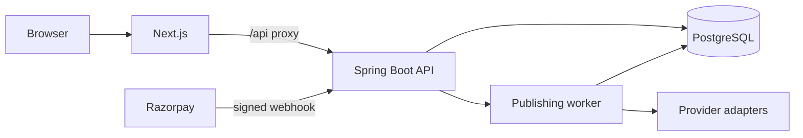

# Architecture

SR Social hub is a modular monolith. The Next.js app is the browser UI. The Spring Boot API owns tenants, permissions, billing state, and publishing. PostgreSQL is the system of record, including the job queue.

## Request path

1. The browser calls the Next.js origin. Rewrites forward `/api/*` to the API, so the session cookie stays first-party.
2. `SessionAuthFilter` resolves the cookie to a user and optional workspace role.
3. `OriginGuardFilter` requires `X-Requested-With: sociallink` on mutating API calls and blocks a suspended workspace.
4. Controllers call services. Services scope every workspace query by `workspace_id`. A cross-workspace id returns 404.
5. Plan limits are read from `plans.limits_json` or a custom subscription override. They are not constants in the UI.

## Publishing path

One post has many `post_targets`. A target is scheduled only after approval when approval is required. If approval arrives after the scheduled time, no job is enqueued and `schedule_block_code` is set.

The worker claims due rows with `FOR UPDATE SKIP LOCKED`, marks the target `publishing`, then asks `PublishPolicy` what to do.

- Unapproved, inactive subscription, or an existing external id does not call a provider.
- A transient failure is retried with exponential backoff and jitter.
- An uncertain result, or a lock that expires while a target is `publishing`, becomes `needs_reconcile` and is not retried blindly.
- Sandbox mode records `sandbox_published` and does not increment usage.
- The live adapter returns a permanent `integration_not_verified` failure. It has no success path.

## Billing path

Checkout does not mark a subscription active. A Razorpay webhook must have a valid HMAC and a new `provider_event_id`. The event row and the subscription update commit together. A duplicate event id does not increment `charge_count`.

## Theme path

`theme_settings` is the source of appearance. The public theme endpoint returns tokens, including foreground colors chosen for contrast. The browser writes those tokens to CSS variables. Saving a theme does not require a redeploy.
